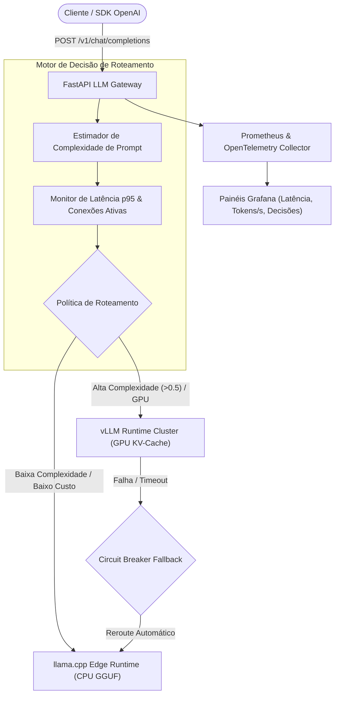

# Gateway Dinâmico de Roteamento de Inferência (LLM Router)

<div align="center">


<p>API Gateway de alta performance compatível com a API OpenAI, que roteia requisições de forma dinâmica e adaptativa entre múltiplos runtimes de inferência (<b>vLLM</b> para cargas complexas e <b>llama.cpp</b> para edge de baixo custo) com observabilidade profunda.</p>

</div>

---

## 🏗️ Topologia de Roteamento Dinâmico



---

## 🏛️ Clean Architecture: Estrutura em Camadas

### 1. Ordem de Escrita (de dentro pra fora)

| Ordem | Camada | Arquivo(s) | Por quê essa ordem |
|---|---|---|---|
| 1 | Domínio / Enums & Modelos | `app/core/domain/enum/runtime_type.py`<br/>`app/core/domain/models/route.py` | Modela o nó de runtime, requisição e decisão de roteamento sem acoplamento a rede ou frameworks. |
| 2 | Domínio / Portas & Interfaces | `app/core/domain/gateway/runtime_client_gateway.py`<br/>`app/core/domain/gateway/health_monitor_gateway.py`<br/>`app/core/domain/gateway/metrics_gateway.py` | Contratos abstratos para disparo de inferência, cluster registry e telemetria Prometheus. |
| 3 | Aplicação / Casos de Uso | `app/core/usecase/route_inference_usecase.py`<br/>`app/core/usecase/get_cluster_telemetry_usecase.py` | Algoritmo de roteamento adaptativo, estimativa de complexidade e fallback com circuit breaker. |
| 4 | Infraestrutura / Adaptadores | `app/infrastructure/gateway/in_memory_node_registry_impl.py`<br/>`app/infrastructure/gateway/runtime_client_impl.py`<br/>`app/infrastructure/gateway/prometheus_metrics_impl.py`<br/>`app/infrastructure/config/settings.py` | Clientes HTTP com tracing OpenTelemetry, métricas Prometheus e cluster registry dinâmico. |
| 5 | Apresentação / API OpenAI | `app/presentation/dtos/router_dto.py`<br/>`app/presentation/api/v1/controllers/router_controller.py`<br/>`app/presentation/api/v1/router.py`<br/>`main.py` | Endpoint compatível com `/v1/chat/completions` e telemetria de cluster `/api/v1/cluster`. |

### 2. Ordem de Leitura (de fora pra dentro)

| Ordem | Pergunta que você está respondendo | Arquivo(s) |
|---|---|---|
| 1 | Quais endpoints OpenAI e de telemetria existem? | `app/presentation/api/v1/router.py` |
| 2 | Como as requisições de chat são processadas? | `app/presentation/api/v1/controllers/router_controller.py` |
| 3 | Como a decisão dinâmica de nó é calculada? | `app/core/usecase/route_inference_usecase.py` |
| 4 | Quais entidades representam os nós e as decisões? | `app/core/domain/models/route.py` |
| 5 | Como o tráfego é despachado para vLLM e llama.cpp? | `app/infrastructure/gateway/runtime_client_impl.py` |

---

## 🐳 Execução via Docker Compose

```bash
# Iniciar Gateway, Prometheus, Grafana e OpenTelemetry Collector
docker compose up --build -d

# Visualizar logs em tempo real
docker compose logs -f llm-router
```

### Portas e Serviços:
- **API Gateway (OpenAI Compatible):** [http://localhost:8000](http://localhost:8000)
- **Documentação Swagger:** [http://localhost:8000/docs](http://localhost:8000/docs)
- **Painel Prometheus:** [http://localhost:9090](http://localhost:9090)
- **Painel Grafana:** [http://localhost:3000](http://localhost:3000) (login: `admin` / senha: `admin`)
- **OpenTelemetry Collector OTLP:** `localhost:4317` (gRPC) / `localhost:4318` (HTTP)

---

## ⚡ Exemplo de Uso com SDK OpenAI (Python)

```python
from openai import OpenAI

client = OpenAI(
    base_url="http://localhost:8000/v1",
    api_key="EMPTY"
)

response = client.chat.completions.create(
    model="default-instruct",
    messages=[
        {"role": "system", "content": "Você é um assistente de engenharia de software."},
        {"role": "user", "content": "Explique a diferença entre vLLM e llama.cpp."}
    ],
    extra_body={"routing_strategy": "COMPLEXITY_ADAPTIVE"}
)

print(response.choices[0].message.content)
```

---

## 🧪 Testes Automatizados

```bash
python -m venv .venv
source .venv/bin/activate
pip install -r requirements.txt
pytest tests/ -v
```

---

## 📄 Licença

Distribuído sob a licença MIT. Consulte `LICENSE` para mais detalhes.
